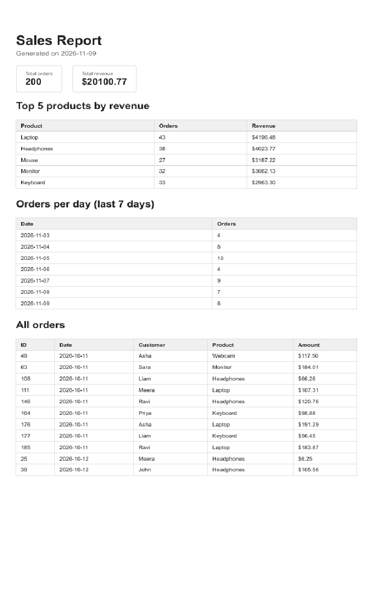

# PDF Report Generator

A small Node.js + Express API that builds a sales report as a PDF. It queries a SQLite database, renders the numbers into an HTML page, prints that page to PDF with Playwright, stores the file on disk, and lets a client download it by link.

Pipeline: **query -> render -> store -> serve**

## Dataset

I chose **Option A, the little shop**: a table `orders` with about 200 random seeded orders (`id`, `customer`, `product`, `amount`, `created_at`) from the last 30 days.

## How to run

Requires Node.js 22 or newer.

```bash
npm install
npx playwright install chromium
node seed.js      # creates report.db and fills it with 200 orders (safe to run twice)
node server.js    # starts the API on http://localhost:3000
```

## API

| Method | Path | What it does |
| --- | --- | --- |
| GET | `/health` | Returns `{ "status": "ok" }` |
| POST | `/reports` | Generates a report. `201` with `{ id, file }`. If one already exists today, returns it with `200`. Send `{ "force": true }` to make a new one. |
| GET | `/reports/:id` | Returns the report record. `404` if the id is unknown. |
| GET | `/reports/:id/file` | Downloads the PDF from disk. |

## Aggregation SQL

All four queries live in `getReportData()` in `report-data.js`.

Total orders and total revenue:

```sql
SELECT COUNT(*) AS total_orders, SUM(amount) AS total_revenue FROM orders
```

Top 5 products by revenue:

```sql
SELECT product, SUM(amount) AS revenue, COUNT(*) AS orders
FROM orders
GROUP BY product
ORDER BY revenue DESC
LIMIT 5
```

Orders per day for the last 7 days:

```sql
SELECT created_at AS day, COUNT(*) AS orders
FROM orders
WHERE created_at >= date('now', '-6 days')
GROUP BY created_at
ORDER BY created_at
```

## Proof: POST -> download

```
> curl.exe -i -X POST http://localhost:3000/reports
HTTP/1.1 201 Created
{"id":1,"file":"/reports/1/file"}

> curl.exe -o reports/my-report.pdf http://localhost:3000/reports/1/file
```

The downloaded `my-report.pdf` opens as a real multi-page PDF.

## Stage 4: when would I move this out of the request?

I would move report generation out of the request once it takes more than a few seconds, or when many users generate reports at the same time, because the request would stay open and could time out while the server is busy making PDFs instead of answering other users

## Stage 5: ask twice, get one

Two rapid POSTs (`node test-double.js`):

```
Two rapid POSTs: [
  { status: 201, body: { id: 1, file: '/reports/1/file' } },
  { status: 200, body: { id: 1, file: '/reports/1/file' } }
]
With force: { status: 201, body: { id: 2, file: '/reports/2/file' } }
```

Both answers carry the same id, and `reports/` gained exactly one file for them.

## Screenshot

